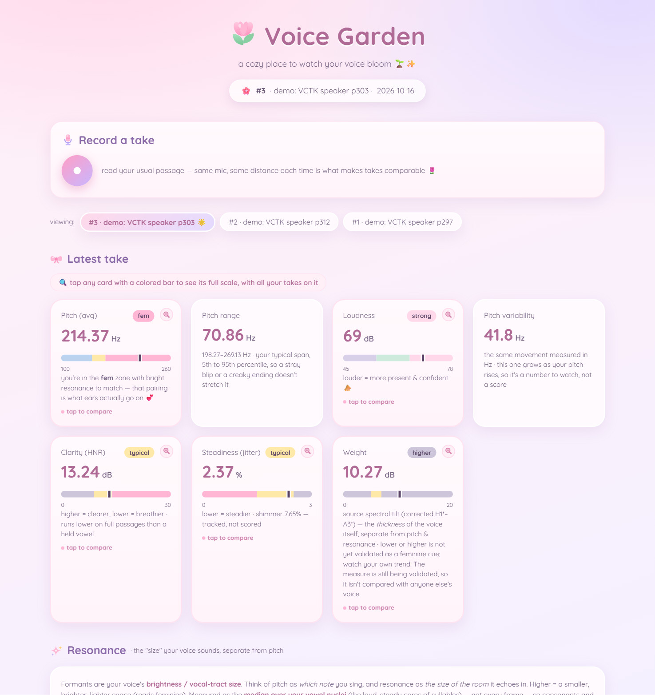

# Voice Garden



This is the only part of this repo that is primarily written by a human!! I am warning you this because I think AI disclosure is important.

This is a cozy voice feminization tool that will analyze your voice and show you metrics. I am not a professional, these metrics are my best understanding of what is useful and accurate but could be entirely wrong. Please use this as only one tool in your voice fem toolkit.

Voice Garden relies heavily on the use of Claude Code, please use Claude Code or a similar coding agent. This tool produces analysis of each voice sample using AI based on your metrics. Instead of embedding this into the UI, it is implemented using skills, so the primary way of interacting with this codebase is via a coding agent, which will run the proper skills and update the UI with the results.

For best results, I recommend that you read the same passage with a similar microphone for all of your tests, so they can be reliably compared. I personally use the Rainbow Passage.

## Usage

Open your coding agent of choice and ask it to read CLAUDE.md. It will give you a summary of how to use this application and work with you to analyze your voice.

If you don't know what a coding agent is or how to do this, [open an issue](https://github.com/spencerduncan/voice-training-ui/issues). I will see about packaging it for you in an easier format, but it will be less useful as I will have to remove the AI features.

## Setup

You'll need [uv](https://docs.astral.sh/uv) (Python), [Node.js](https://nodejs.org) 20 or newer, and ffmpeg:

- macOS: `brew install ffmpeg`
- Debian/Ubuntu: `sudo apt-get install ffmpeg`
- Windows: `winget install --id Gyan.FFmpeg` (then open a new terminal so it's on your PATH)

Then, from the project folder, run these one at a time (this works the same in bash, zsh, fish and Windows PowerShell):

```sh
uv sync
cd dashboard-react
npm ci
npm run dev
```

and open <http://localhost:5173>.

- **Never start the dashboard with `--host`** while you have takes recorded — that serves your recordings to everyone on your network. The default only listens on your own machine.
- `npm audit` may list advisories in dev-only tools (Vite, esbuild and the like). Those are about the local dev server and build tooling, not your recordings, which are plain files on your disk that nothing uploads. **Don't run `npm audit fix --force`** — it jumps to major versions this dashboard isn't built for.

### Recording a take

With the dashboard running (`npm run dev`), the **Record a take** panel at the top records from your microphone, lets you listen back, and — once you say what you were going for — runs the analyzer for you; the take shows up on the dashboard straight away. The audio goes only to the dev server on your own machine. Your browser's echo cancellation, noise suppression and auto-gain are switched off so they don't reshape what's being measured. You can also save the file and run `uv run analyze.py` on it yourself; the panel shows the exact command.

## Your recordings stay on your machine 🌷

`dashboard-react/public/audio/` and `dashboard-react/public/analysis/` ship **empty on purpose** — only a `.gitkeep` placeholder is in each. Those two folders and `recordings.json` are gitignored, so your takes and their measurements stay local and won't ride along if you commit or push this repo.

**Takes, audio, analysis JSON and annotation entries are local and never committed** — that's `recordings.json` (both copies), `dashboard-react/public/audio/`, `dashboard-react/public/analysis/`, and the per-take insight files in `dashboard-react/src/annotations/entries/` (only `_example.tsx` is tracked).

One caveat if you cloned rather than downloaded: `recordings.json` and its `dashboard-react/public/` mirror are tracked as empty `[]` starters, and git keeps following a file once it's tracked — gitignore only applies to files git isn't already watching. So the log of your takes (labels, notes, numbers — not the audio) can still land in a commit. If you'd rather git forgot those two files entirely, run this once:

```sh
git rm --cached recordings.json dashboard-react/public/recordings.json
```

That leaves both files exactly where they are on disk; it only tells git to stop watching them. Your audio and analysis files are ignored either way.

## License

All code and content I wrote — `analyze.py`, the React dashboard, the Claude Code skill, and the docs — is licensed under the **MIT License** (see `LICENSE`).

Additionally, in jurisdictions where statements of this kind are legal, I dedicate my own code and content to the **public domain** — you may use it under either the MIT License or as public domain. (I offer this because many countries lack a legal framework for public-domain dedication.) This does **not** apply to the third-party assets credited below.

**Note on the analyzer's GPL dependency:** `analyze.py` uses **Praat** (via the **parselmouth** library) at runtime, both of which are **GPLv3**. The source here contains none of their code and is distributed source-only — you install parselmouth separately (via `uv`) — so this code stays MIT / public domain. **However**, if you distribute a *bundled artifact* that ships Praat/parselmouth together with this code (a compiled binary, a packaged app, a Docker image with them baked in, etc.), that combined work is covered by the **GPLv3** and must be licensed accordingly.

## Credits & third-party assets

- **Reference voices** — the preview clips in `dashboard-react/public/reference-audio/` and the measured values in `reference.json` are derived from the **VCTK Corpus** (CSTR, University of Edinburgh — Veaux, Yamagishi & MacDonald), licensed **CC BY 4.0**. Each preview concatenates the same four Rainbow Passage sentences per speaker (VCTK text ids 009–012) and is transcoded to mono mp3; the values in `reference.json` are measured on that preview audio. These files remain under **CC BY 4.0**. <https://datashare.ed.ac.uk/handle/10283/3443> · <https://creativecommons.org/licenses/by/4.0/>
- **Quicksand** font (`dashboard-react/src/fonts/quicksand-latin.woff2`) — © 2011 The Quicksand Project Authors, licensed under the **SIL Open Font License 1.1** (see `dashboard-react/src/fonts/OFL.txt`).
- **Praat** (Boersma & Weenink) and **parselmouth** (Jadoul, Thompson & de Boer), both **GPLv3**, power `analyze.py`.
- Other dependencies (React, Vite, wavesurfer.js, NumPy, …) retain their own respective licenses.
